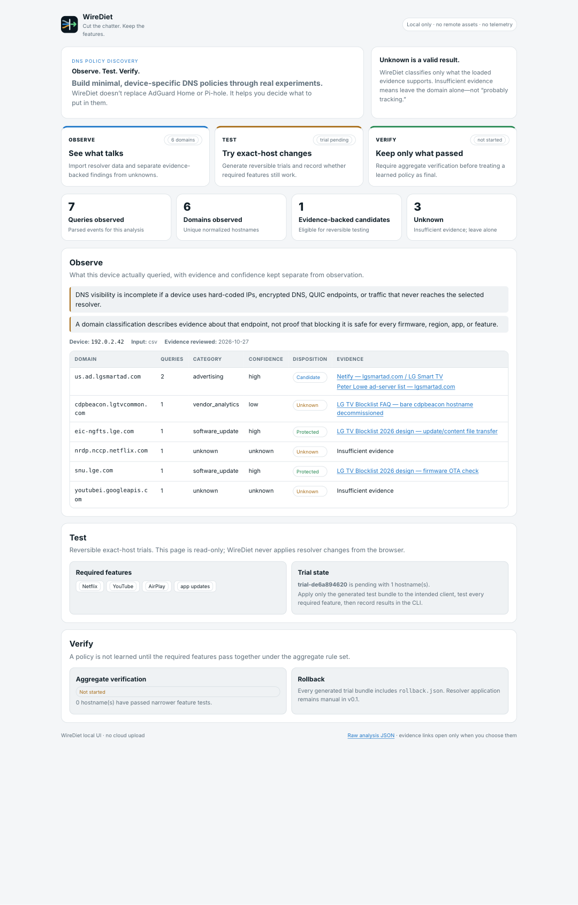

<p align="center">
  
</p>

# WireDiet

**Cut the chatter. Keep the features.**

WireDiet is an experiment harness for building minimal, device-specific DNS policies. Import real query logs, test candidate blocks, record what breaks, and export only the policy you actually verified.

**WireDiet doesn't replace AdGuard Home or Pi-hole. It helps you decide what to put in them.**

<p align="center">
  
</p>

*Actual local UI rendered from the repository's synthetic fixture. No household DNS history is used in screenshots.*

## What WireDiet does differently

Pi-hole, AdGuard Home, dnsmasq, Unbound and OpenWrt are enforcement layers. They are good at applying DNS policy.

WireDiet works one layer earlier: **policy discovery and verification**.

```text
observe a real device
→ classify only what evidence supports
→ generate reversible exact-host trials
→ test the features you care about
→ narrow failures
→ verify the aggregate policy
→ export rules to your existing DNS tool
→ rollback when needed
```

WireDiet is **not**:

- a DNS server
- an AdGuard Home or Pi-hole replacement
- a giant tracker blocklist
- a system that turns UNKNOWN into “probably telemetry”
- an automatic router configuration tool

## Observe → Test → Verify

### Observe

Import resolver data for one device or client. WireDiet normalizes hostnames, counts observations, and attaches classification only when the loaded evidence supports it.

An unknown domain stays unknown.

> **Insufficient evidence. Leave this domain alone.**

That is a valid analysis result, not a failure state.

### Test

Evidence-backed candidates can enter reversible trials. WireDiet generates exact-host policy bundles plus rollback information. You decide which features must keep working and record pass/fail/skip results.

If a batch fails, the experiment engine narrows the failing set instead of declaring the whole batch bad.

### Verify

A smaller trial passing is not enough. WireDiet requires the aggregate learned policy to pass the required-feature check before final export. Interaction failures block finalization.

Resolver application remains manual in v0.1.

## Install

### macOS — Homebrew (recommended)

```bash
brew install maliroq/tap/wirediet
wirediet version
```

Homebrew builds WireDiet locally from the tagged source release. It does **not** install an unsigned downloaded macOS executable and does not require weakening Gatekeeper.

Run `wirediet help` to see the available commands, then use the Quick start below for your first analysis.

To uninstall the Homebrew package:

```bash
brew uninstall wirediet
```

WireDiet does not install a daemon or system service, and uninstalling the formula does not remove experiment files you created yourself.

### Go install — macOS, Linux, Windows

If you already have Go 1.23+:

```bash
go install github.com/maliroq/wirediet/cmd/wirediet@v0.1.0-preview.5
wirediet version
```

On Windows, this is a compile-gated source installation path, not a claim of independently validated Windows runtime/distribution behavior.

### Linux prebuilt archives

The GitHub release provides two verified Linux archives:

- `wirediet_0.1.0-preview.5_linux_amd64.tar.gz` — x86-64 Linux
- `wirediet_0.1.0-preview.5_linux_arm64.tar.gz` — ARM64 Linux

It also publishes `SHA256SUMS.txt` and `wirediet_0.1.0-preview.5_source.zip`. Verify a downloaded release directory on macOS with:

```bash
shasum -a 256 -c SHA256SUMS.txt
```

On Linux, `sha256sum -c SHA256SUMS.txt` is also supported.

### macOS distribution boundary

WireDiet intentionally does not distribute an unsigned downloaded macOS executable. A downloaded unsigned CLI was blocked by Gatekeeper during real validation, so WireDiet does not ask users to weaken macOS security. Use Homebrew, `go install`, or build from source.

### Build from source

```bash
git clone https://github.com/maliroq/wirediet.git
cd wirediet
go test ./...
go build -trimpath -o wirediet ./cmd/wirediet
```

## Quick start

Analyze a saved resolver export:

```bash
wirediet scan \
  --input query-log.json \
  --format adguard \
  --device 192.0.2.42 \
  --out analysis.json
```

Open the local UI:

```bash
wirediet serve --analysis analysis.json
```

Then visit `http://127.0.0.1:8787`.

If you already have an experiment session, the same read-only UI can show its Test/Verify state:

```bash
wirediet serve \
  --analysis analysis.json \
  --session .wirediet/session.json
```

Start a trial:

```bash
wirediet experiment init \
  --analysis analysis.json \
  --features "Netflix,YouTube,AirPlay,app updates" \
  --session .wirediet/session.json

wirediet experiment next \
  --session .wirediet/session.json \
  --out-dir .wirediet/policies
```

After manually applying the generated test policy only to the intended client, record every required feature:

```bash
wirediet experiment record \
  --session .wirediet/session.json \
  --trial trial-REPLACE_ME \
  --results "Netflix=pass,YouTube=pass,AirPlay=pass,app updates=pass"
```

When aggregate verification passes:

```bash
wirediet export \
  --session .wirediet/session.json \
  --out-dir final-policy
```

## Supported input sources

v0.1 supports saved/offline input from:

- AdGuard Home query-log JSON
- Pi-hole v6 query JSON
- dnsmasq-compatible query logs
- generic CSV
- generic JSON

WireDiet does not ask for resolver credentials during normal analysis.

See [`docs/adapters.md`](docs/adapters.md).

## Supported policy exports

Generated bundles include exact-host output for:

- AdGuard Home
- Pi-hole/domain lists
- dnsmasq / OpenWrt
- Unbound
- hosts-style lists

Each trial bundle includes `rollback.json`.

Exact-host behavior is tested so an intended block for `telemetry.example.com` does not silently become a suffix-wide block for unrelated parent/sibling/subdomain names.

## Real-world validation

The current evidence boundary is deliberately narrow.

On October 27, 2026, WireDiet was exercised against a real native AdGuard Home v0.107.79 instance and one isolated external client:

- **147 AdGuard Home entries → 147 WireDiet events**
- one real external-client baseline succeeded
- the real baseline contained **43 unique domains**
- WireDiet found **0 defensible evidence-backed low-risk candidates**
- an independent exact-domain Tracker Radar cross-check also found **0 low-risk candidates**
- no UNKNOWN hostname was promoted just to create a test
- a separately labeled controlled exact-host trial blocked only its target hostname
- parent and sibling hostnames continued resolving normally
- two selected client features continued working during that controlled trial
- rollback restored normal resolution and automatic client DNS

Still **NOT VERIFIED**:

- a real smart-TV/IoT feature-preservation trial
- a live failure/split cycle

Those remain limitations, not implied successes.

See [`docs/real-world-validation-2026-10-27.md`](docs/real-world-validation-2026-10-27.md) and the sanitized reproducibility artifact in [`docs/reproducibility/`](docs/reproducibility/).

Historical real-world evidence is kept separate from per-run harness output. `python3 dev.py --phase-a-only` correctly marks physical-device gates `NOT VERIFIED` for that invocation and writes `artifacts/current_run_reproducibility_report.*`; it does not overwrite the committed 2026-10-27 real-world record.

## Privacy model

DNS history can reveal household behavior. WireDiet treats it as sensitive input.

- local-first processing
- no account
- no telemetry
- no cloud upload
- no remote analytics
- no runtime evidence lookup
- local UI binds only to loopback
- no remote browser assets
- generated private artifacts use owner-only permissions where supported
- public/redacted output removes local identifiers, but queried public domains still require human review before sharing

The local UI is read-only. Evidence links are opened only if you click them.

See [`docs/privacy-model.md`](docs/privacy-model.md) and [`docs/threat-model.md`](docs/threat-model.md).

## Packaging

Tagged releases publish a source archive plus prebuilt **Linux amd64 and Linux arm64** archives with SHA-256 checksums.

For macOS, use Homebrew or the source-built installation paths above. WireDiet intentionally does not distribute an unsigned downloaded macOS executable after real validation showed Gatekeeper blocking that path. Windows remains source/Go-install only until its real distribution experience is independently validated.

Startup:

```bash
wirediet version
wirediet serve --analysis analysis.json
```

Cleanup/uninstall for a standalone binary is simply:

```bash
rm ./wirediet
rm -rf .wirediet/        # only if you also want to remove local experiment state
```

WireDiet does not install a daemon or system service.

## Contribute a redacted, verified device experiment

The most useful community contribution is not a raw DNS dump and not a universal blocklist entry. It is a **redacted, reproducible device experiment/profile**.

A useful profile records:

- device/model family
- firmware/version when known
- region when relevant
- exact hostname(s) observed
- whether each hostname is merely observed, evidence-backed candidate, or verified by experiment
- evidence source(s)
- exact features tested
- exact trial policy
- pass/fail/partial result
- aggregate verification state
- verification date
- explicit redaction review

Never submit raw household DNS history, MAC addresses, private IPs, device names, credentials, resolver tokens or router backups.

One person's result never becomes universal truth automatically.

See [`CONTRIBUTING.md`](CONTRIBUTING.md), [`docs/community-data.md`](docs/community-data.md), and [`profiles/schema/device-profile.schema.json`](profiles/schema/device-profile.schema.json).

## Known limitations

- DNS visibility is incomplete when devices use hard-coded IPs, encrypted DNS, QUIC endpoints or traffic that bypasses the selected resolver.
- Classification describes evidence about an endpoint; it is not proof that blocking is safe for every firmware, region, app or feature.
- v0.1 does not automatically mutate resolver/router configuration.
- per-client rule scoping depends on the enforcement layer and remains the operator's responsibility.
- the bundled evidence set is intentionally small.
- real smart-TV/IoT feature preservation remains unverified.

## Validation

Run the deterministic release gate:

```bash
python3 dev.py --phase-a-only
```

For the guided resolver/device workflow on macOS:

```bash
python3 dev.py
```

The harness preserves `NOT VERIFIED` rather than converting missing real-world evidence into PASS.

## Technical and security documentation

- [`docs/architecture.md`](docs/architecture.md)
- [`docs/evidence.md`](docs/evidence.md)
- [`docs/security-audit-2026-10-27.md`](docs/security-audit-2026-10-27.md)
- [`docs/live-validation.md`](docs/live-validation.md)
- [`docs/presentation-audit-2026-10-27.md`](docs/presentation-audit-2026-10-27.md)
- [`docs/research-2026-10-26.md`](docs/research-2026-10-26.md)
- [`SECURITY.md`](SECURITY.md)

## License

MIT. See [`LICENSE`](LICENSE).
